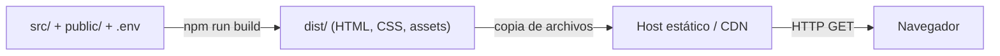
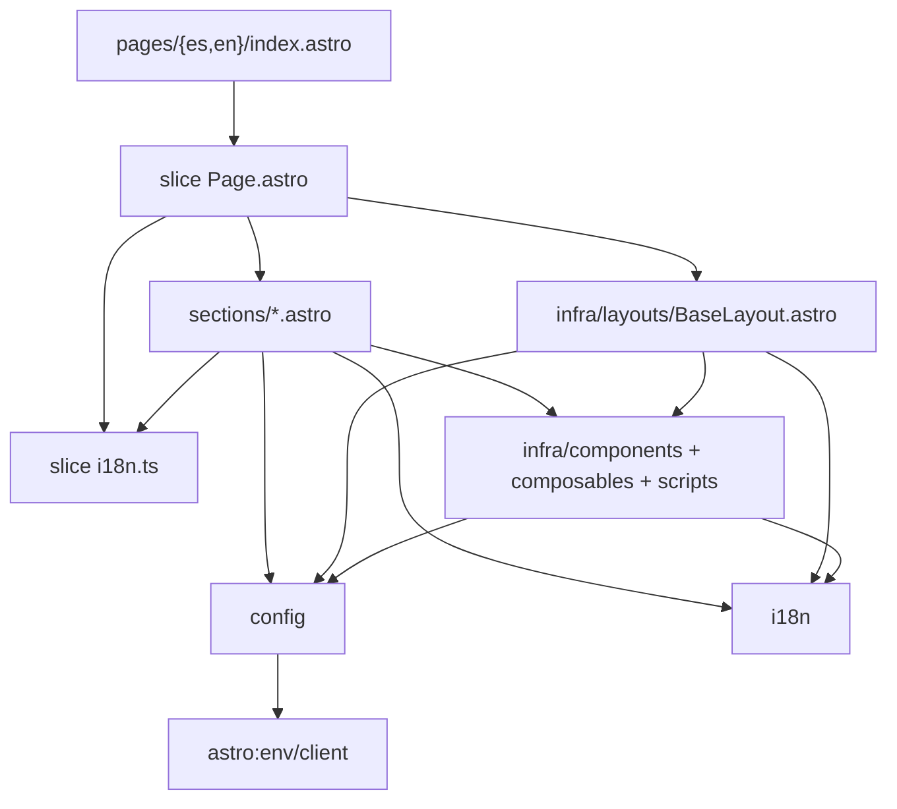

# Diseño del sistema

Estado: vigente. Este documento describe el sistema tal como está construido hoy.
El código es la fuente de verdad; si el texto y el código divergen, el código gana
y este documento se corrige. Las decisiones y sus alternativas viven en
[`docs/decisions/`](./decisions/).

## 1. Resumen

`trebor-portfolio` es un sitio estático bilingüe generado con Astro. El build
produce HTML, CSS y unos pocos scripts; no hay servidor de aplicación, base de
datos, API ni sesión de usuario. La superficie de ejecución se limita a un
navegador que descarga archivos estáticos.

El sistema se organiza en tres capas con una regla de dependencia en un solo
sentido: `pages` (rutas y slices) → `infra` → `config` / `i18n`. La capa `infra`
nunca importa páginas, y la configuración no importa ninguna otra capa.

## 2. Requisitos y restricciones

| Requisito | Consecuencia en el diseño |
|---|---|
| Salida estática, desplegable en cualquier CDN | `output: 'static'`; todo se prerenderiza en el build |
| Dos idiomas, español por defecto | Rutas con prefijo de locale; copy tipado por locale |
| Mínimo JavaScript en el navegador | Componentes Vue sin `client:*`; sin framework de hidratación |
| Velocidad y contenido como prioridad | Sin router, sin estado global, sin fuentes remotas |
| Un solo mantenedor | Convenciones explícitas en `AGENTS.md` y en este documento |
| Node `>=22.23.4`, ESM | `"type": "module"`; sin dependencias CommonJS propias |

Restricciones deliberadas: no hay content collections, Pinia, router, tests,
linter, formatter ni `astro check`. No se añaden sin pedirlo.

## 3. Contexto de ejecución



- El entorno (`.env`) se lee **en el build**. Cambiar una variable exige reconstruir.
- El host solo sirve archivos; no ejecuta Node ni resuelve rutas dinámicas.
- El navegador no habla con ningún backend del proyecto.

## 4. Mapa de módulos

```
src/
├── config/                  # superficie única de configuración
│   ├── env.ts               # valores tipados de astro:env/client
│   ├── site.ts              # locales, defaultLocale, metadatos, rutas
│   └── index.ts             # barrel público
├── i18n/
│   ├── ui.ts                # cadenas de chrome compartido + t()
│   └── utils.ts             # isLocale, getLocaleFromPath, localePath, alternateLocale
├── infra/                   # compartido y agnóstico de contexto
│   ├── components/          # BaseButton.vue, LocaleSwitcher.vue, ThemeToggle.astro, ArrowIcon.astro
│   ├── composables/         # useI18n()
│   ├── layouts/             # BaseLayout.astro
│   ├── scripts/             # smooth-scroll.ts
│   └── styles/              # global.css y sus capas
└── pages/
    ├── index.astro          # / → /es/ (302)
    ├── es/index.astro       # monta el slice con lang="es"
    ├── en/index.astro       # monta el slice con lang="en"
    └── _contexts/           # fuera del router
        └── home/index/
            ├── Page.astro   # raíz del slice: layout + secciones + scripts
            ├── sections/    # secciones privadas del slice
            └── i18n.ts      # copy del home para todos los locales
```

| Módulo | Responsabilidad | Depende de | No puede importar |
|---|---|---|---|
| `src/config` | Leer entorno y declarar locales, sitio y rutas | `astro:env/client` | `infra`, `pages`, `i18n` |
| `src/i18n` | Traducir chrome compartido y construir URLs | `config` | `pages`, `infra` |
| `src/infra` | Componentes, layout, estilos y utilidades reutilizables | `config`, `i18n` | `pages` (ningún slice) |
| `src/pages/_contexts` | Composición y copy de una página | `infra`, `config`, `i18n`, su propio `i18n.ts` | otros slices |
| `src/pages/{es,en}` | Cablear una ruta con su slice | slice de la página | lógica o markup de página |

Reglas duras:

1. `infra` no importa `pages`. Un componente usado por un solo slice vive en el
   slice, no en `infra`.
2. Los archivos de ruta son cableado de tres líneas: importan el slice y le pasan
   el locale. Nunca contienen markup de página.
3. Toda página existe en `es/` y `en/`; una ruta en un solo idioma rompe el
   selector de idioma y los `hreflang`.
4. Los imports internos usan el alias `@/*`; no hay rutas relativas que suban de
   capa.



## 5. Flujo de una página

1. `astro build` evalúa `astro.config.mjs`, que declara el esquema de `astro:env`,
   el enrutado i18n y las integraciones.
2. Astro resuelve cada archivo de `src/pages/{es,en}/` como una ruta.
3. `es/index.astro` y `en/index.astro` importan `home/index/Page.astro` y le pasan
   `lang`.
4. `Page.astro` selecciona `homeCopy[lang]`, monta `BaseLayout` y ordena las ocho
   secciones dentro de `.slide-stack`.
5. `BaseLayout` importa `global.css` una sola vez, escribe todo el metadata del
   documento (canonical, `hreflang`, `x-default`, Open Graph) y pinta cabecera,
   `main` y pie.
6. Cada sección recibe `lang`, lee su parte de `homeCopy` y renderiza HTML. No
   recibe datos de red.
7. El resultado se escribe en `dist/`; no queda proceso en ejecución.

## 6. Renderizado e hidratación

Astro renderiza todas las rutas en el build. Los componentes Vue
(`BaseButton.vue`, `LocaleSwitcher.vue`) se ejecutan en el servidor y emiten HTML;
no llevan `client:*`, así que **no se hidratan**. Esto es cero-hidratación, no
cero-JavaScript: el sitio envía scripts pequeños y explícitos.

La tabla enumera las siete piezas de JavaScript por origen. Astro agrupa los
scripts de componentes en un único módulo de página y conserva inline el script de
tema previo al pintado.

| Script | Ubicación | Se ejecuta | Propósito | Sin JS |
|---|---|---|---|---|
| Tema inicial | `BaseLayout.astro` (`is:inline`) | Antes del primer pintado | Aplicar `data-theme` guardado | Usa `prefers-color-scheme` |
| Toggle de tema | `ThemeToggle.astro` | Al hacer clic | Alternar y persistir tema | El botón no cambia nada |
| Scroll y pantallas | `Page.astro` + `smooth-scroll.ts` | Al navegar y al cargar | Glide por tiempo, blur de vista, `--drift`/`--fade`, anclas y hash | Las pantallas siguen apiladas por CSS |
| Cascada del proceso | `BuildProcess.astro` | Al entrar en viewport | Dibujar las reglas y revelar las cuatro conversaciones | El proceso queda visible |
| Cascada del manifiesto | `Manifesto.astro` | Al entrar en viewport | Dibujar el eje y revelar las seis estaciones en orden | El manifiesto queda visible |
| Entrada del kit | `Tools.astro` | Al entrar en viewport | Animación escalonada | Las tarjetas quedan visibles |
| Formulario de contacto | `Contact.astro` | Al enviar | Validar y componer el correo | El enlace `mailto:` sigue |

La sección de proyectos no aparece en la tabla: el índice de empresas cambia la
ficha con radios nativos y `:has()`, sin script. Es el único comportamiento
interactivo del home que no envía JavaScript.

Regla: ningún contenido depende de JavaScript para existir. Sin JS se pierden dos
comportamientos —el selector de tema y el navegador de secciones— pero el
contenido, el detalle de proyectos, el tema del sistema y las pantallas apiladas
siguen disponibles.

## 7. Internacionalización

- `locales = ['es', 'en']`, `defaultLocale = 'es'`.
- `prefixDefaultLocale: true`: toda URL es `/es/…` o `/en/…`.
- `/` redirige con 302 a `/es/` desde `src/pages/index.astro`.
- El chrome (cabecera, pie, accesibilidad) vive en `src/i18n/ui.ts` y se resuelve
  con `t(locale, key)`; el copy de página vive en el `i18n.ts` del slice.
- El tipo `Locale` se deriva de `locales`; añadir un idioma obliga al compilador a
  señalar cada `Record<Locale, …>` incompleto.
- Las URLs se construyen con `localePath(locale, path)`, puro y usable en Astro y
  Vue. `astro:i18n` se reserva para código exclusivo de Astro.
- `BaseLayout` es el único lugar que escribe canonical, alternates y `x-default`.

Añadir una página exige cuatro cambios coordinados: el slice con su `Page.astro`,
`sections/` e `i18n.ts`; la ruta en `es/`; la ruta en `en/`; y, si aplica, la clave
en `site.routes`.

## 8. Presentación y tokens

- `src/infra/styles/global.css` es la única hoja importada, y solo desde
  `BaseLayout.astro`. Orden: Tailwind, tokens, base, slides, utilidades.
- Los tokens viven en `theme.css` bajo `@theme static`. Generan utilidades
  (`bg-page`, `text-ink`, `border-line`, `rounded-card`) y siguen disponibles como
  variables CSS. Nunca se codifica un color, radio o fuente en un componente.
- El tema claro es el valor por defecto; oscuro se activa por
  `prefers-color-scheme` o por `data-theme` en `<html>`, persistido en
  `localStorage` con el script previo al pintado.
- Sin `tailwind.config.js`: Tailwind 4 se configura en CSS.
- Las utilidades compartidas (`page-container`, `site-frame`, `eyebrow`, `noise`,
  `skip-link`, `section-glow`, `ambient-field`, `ambient-orb`) viven en
  `utilities.css` como `@utility`. Un valor de un solo uso usa sintaxis arbitraria.
- Las secciones del home forman pantallas apiladas con `position: sticky` y
  `100dvh` en `slides.css`, solo desde `1024 × 720`. Por debajo, el flujo vuelve a
  ser vertical. El cubrimiento no necesita JavaScript.

## 9. Entorno y configuración

Variables declaradas en `astro.config.mjs`, documentadas en `.env.example` y
reexportadas en `src/config/env.ts`:

| Variable | Contexto | Obligatoria | Uso |
|---|---|---|---|
| `PUBLIC_SITE_URL` | cliente | no | `site`, canonical, `hreflang` |
| `PUBLIC_SITE_NAME` | cliente | no (default `Trebor`) | Marca en cabecera, pie y títulos |
| `PUBLIC_CONTACT_EMAIL` | cliente | no | Enlaces `mailto:` y CTA de contacto |

Regla de tres sitios: esquema en `astro.config.mjs`, entrada en `.env.example`,
reexportación en `src/config/env.ts`. El consumo es siempre `@/config`, nunca
`import.meta.env` ni `astro:env` desde páginas. Todo lo declarado aquí es público y
termina en el bundle: no admite secretos.

## 10. Build y despliegue

```sh
npm install
npm run build     # genera dist/ con HTML, CSS y assets
npm run preview   # sirve el build localmente
```

- `dist/` es el artefacto completo. El despliegue es copiar ese directorio.
- No hay variables de runtime ni funciones del servidor.
- `PUBLIC_SITE_URL` debe fijarse en el build de producción: sin ella, canonical y
  `hreflang` apuntan a `http://localhost:4321`.
- Fuentes y retrato se sirven desde `public/`; no hay peticiones a terceros.
- `dist/`, `.astro/`, `node_modules/` y `graphify-out/` no se versionan. `.env` y
  `.env.production` están en `.gitignore`; `.env.example` sí se versiona.

## 11. Degradación y fallos

| Escenario | Comportamiento |
|---|---|
| Sin JavaScript | Todo el contenido y las pantallas apiladas siguen visibles; el detalle de proyectos se cambia con radios nativos; el manifiesto aparece completo; el formulario no compone el correo y queda el enlace `mailto:`; solo falta el navegador de secciones |
| Viewport menor de `1024 × 720` | El home vuelve al flujo vertical normal; el modo apilado no se activa |
| `prefers-reduced-motion: reduce` | La rueda y las teclas pasan al scroll nativo; los saltos de sección usan el scroll nativo y, en puntero fino, conservan el desenfoque de vista |
| Puntero táctil o grueso | La rueda no se intercepta; se conserva la inercia del sistema |
| `localStorage` no disponible | El tema funciona por sesión; el error se ignora |
| `PUBLIC_CONTACT_EMAIL` vacío | Los CTAs apuntan a `#contacto`; el formulario se renderiza pero no puede enviar y muestra el aviso de no configurado |
| `PUBLIC_SITE_URL` vacío | Se usa `http://localhost:4321` para canonical y `hreflang` |
| Navegador sin `IntersectionObserver` | Las animaciones de entrada no se ejecutan; el contenido permanece visible (`BuildProcess` lo comprueba explícitamente, el resto falla en silencio) |
| Host sin reescrituras | Solo funcionan las rutas de archivo reales; `/` es un archivo generado |

## 12. Verificación

Cualquier cambio:

1. `npm run build` debe terminar sin errores.
2. Revisar `/es/` y `/en/` en el servidor de desarrollo, no solo el fuente.
3. Comprobar que el HTML construido no incorpora scripts de hidratación de Vue
   (`client:*`). Los scripts permitidos son los siete de la tabla de §6.
4. Revisar que el texto visible no esté codificado en `.astro` o `.vue`: debe
   venir de `src/i18n/ui.ts` o del `i18n.ts` del slice.
5. Si se tocó configuración, verificar los tres sitios de §9 y reconstruir.

No existe suite de tests, linter ni `astro check`. No se asume que existan.

## 13. Límites conocidos y deuda

- La documentación se mantiene a mano; no hay generación automática ni comprobación
  de enlaces. Revisar `docs/` al cambiar una frontera o un nombre de archivo.
- No hay tests ni comprobación de tipos independiente (`@astrojs/check` no está
  instalado). La validación real es el build.
- Los logos de empresa son monogramas hasta que existan los archivos en
  `public/logos/`; el hueco, la placa y el tamaño ya están en el componente.
- El formulario de contacto compone un `mailto:` con nombre, correo y mensaje;
  EmailJS todavía no está conectado y, sin `PUBLIC_CONTACT_EMAIL`, no puede enviar.
- El build emite un `dist/_astro/client.*.js` (runtime de Vue) que ningún HTML
  referencia. No se descarga, pero ocupa espacio en `dist/`; comprobar que no
  aparezca un `<script src>` hacia él al añadir una isla.
- `docs/visual-reference.md` conserva una propuesta de paleta anterior; la paleta
  vigente es la de `src/infra/styles/theme.css`.
- El sitio no tiene CMS: el copy se edita en los `i18n.ts` y se reconstruye.

## 14. Decisiones

| ADR | Decisión |
|---|---|
| [0001](./decisions/0001-astro-estatico-vue-sin-hidratacion.md) | Astro estático con Vue solo en build |
| [0002](./decisions/0002-contextos-y-slices.md) | Contextos delimitados y slices verticales |
| [0003](./decisions/0003-rutas-con-prefijo-de-locale.md) | Rutas con prefijo de locale y copy tipado |
| [0004](./decisions/0004-progressive-enhancement.md) | Mejora progresiva y cero hidratación |
| [0005](./decisions/0005-tokens-css-first.md) | Tailwind 4 CSS-first con tokens centralizados |

Cuando una decisión cambie, se escribe un ADR nuevo que referencia y reemplaza al
anterior. Los ADR no se borran.
